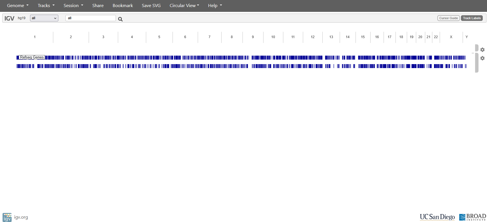
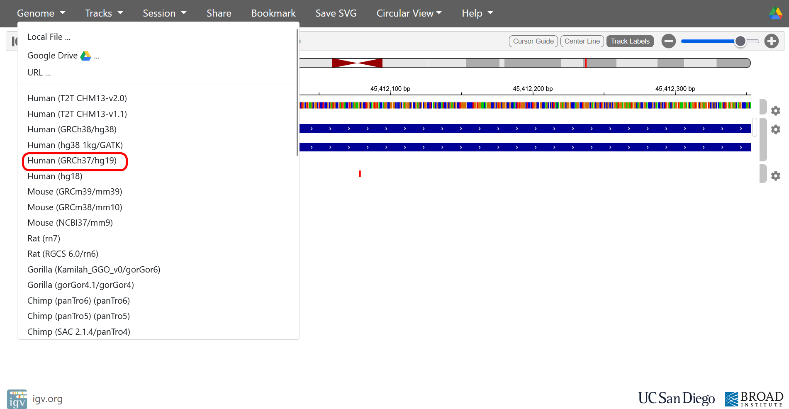
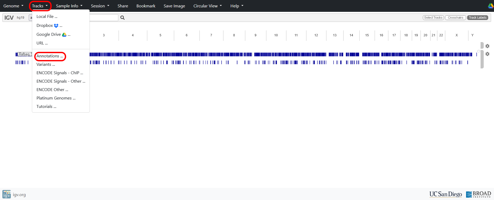
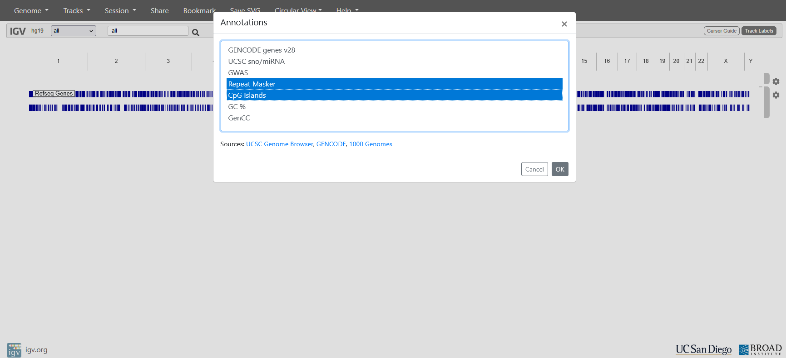
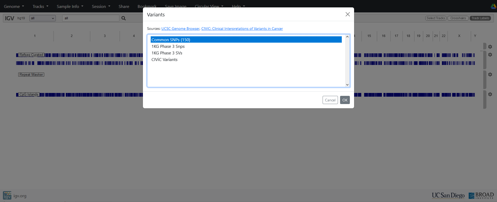
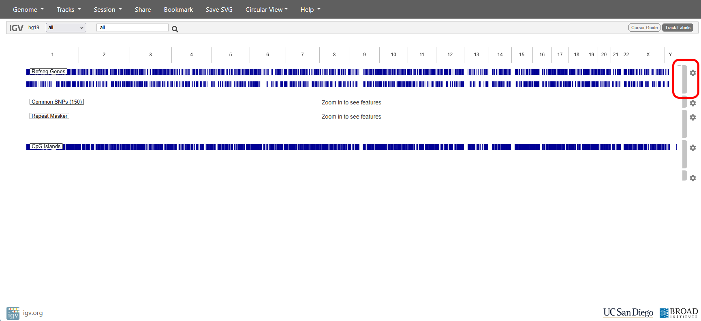

# Set up IGV and annotation tracks

Use your favourite internet browser to navigate to  [https://smb-informatics.mvls.gla.ac.uk/igv](https://smb-informatics.mvls.gla.ac.uk/igv){target="_blank" rel="noopener noreferrer"} (Note: if off campus, you will need to connect using the University VPN - [https://www.gla.ac.uk/myglasgow/it/vpn/](https://www.gla.ac.uk/myglasgow/it/vpn/){target="_blank" rel="noopener noreferrer"})

You should see a window like this:

{fig-alt="Screenshot of IGV"}

The platinum WGS data we will be using have been aligned to version hg19 of the human reference genome, so we will need to first select the GRCh37/hg19 reference sequence from the genome menu:

{fig-alt="How to change the reference in IGV"}

In order to interpret the sequence data, we are going to add some additional “Annotation” “Tracks” to the IGV window:

{fig-alt="How to add annotations to IGV"}

Use Shift+Click to select the Repeat Masker and CpG Islands annotation tracks (in addition to the Refseq Genes track which is a default track):

{fig-alt="Selecting specific annotations in IGV"}

We can also add some known “variants” as a track from the dbSNP database (version 150):

{fig-alt="Adding the variant track to IGV"}

Your window should now look something like this (you can use the grey handle on the right to drag the Refseq Gene annotation back to the top):

{fig-alt="How to move and edit tracks in IGV"}

