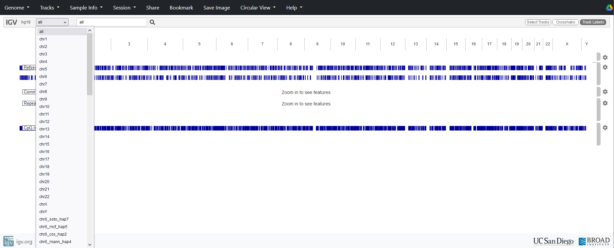
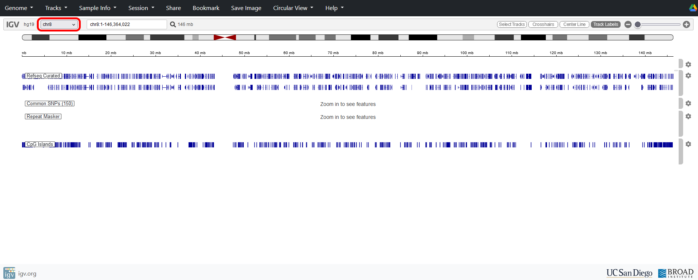
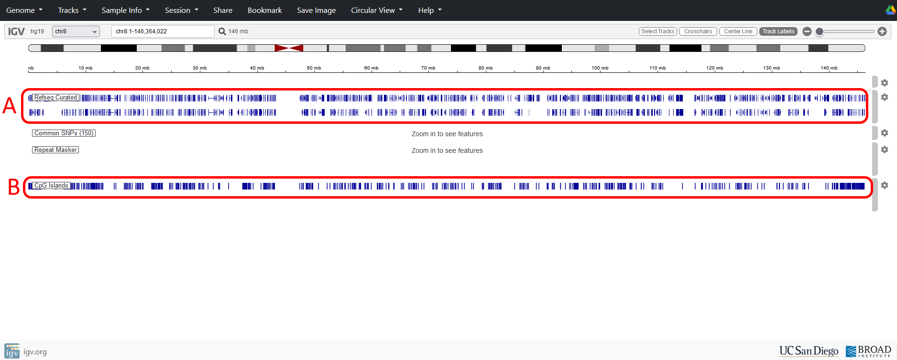
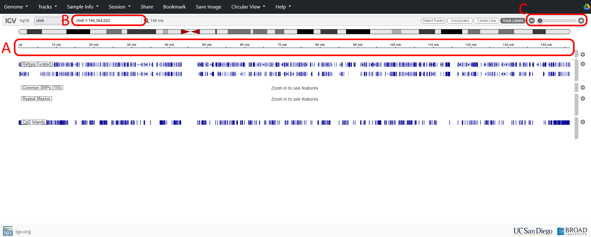
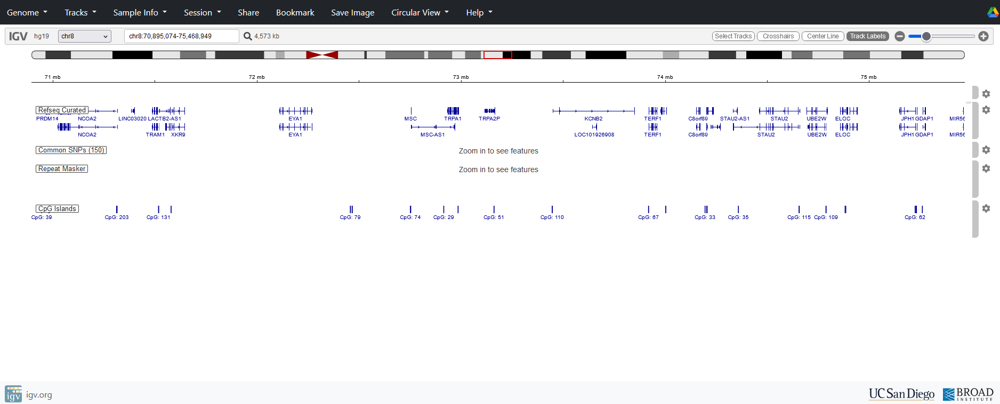
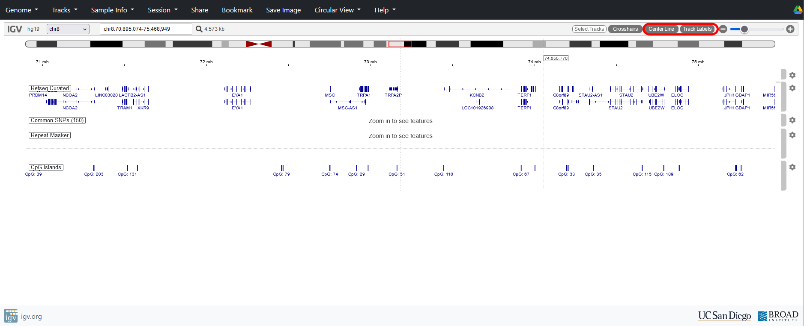

# 3: Navigate the genome

Before looking at any sequence data, get a feel for navigating around the genome and remind yourself of some features of genome organisation.

To see more detail, we need to focus on a smaller region of the genome. There are various ways to do this, including selecting a chromosome either using the pull-down menu, or the chromosome buttons:

{fig-alt="Select a chromosome in IGV"}

Let’s look at chromosome 8:

{fig-alt="A view of chromosome 8 in IGV"}

At this level we can start to see some detail regarding the distribution of known genes (A) and CpG islands (B).

{fig-alt="A figure showing how to move position in IGV"}

We can zoom in further by either clicking and dragging on the scale  (A), typing in sequence coordinates (B), or using the zoom buttons (C).

{fig-alt="How to move position in IGV"}

Try pressing the + zoom button **five** times:

You should now start to see individual genes and CpG islands. Note how genes and inter-genic regions differ in size.

{fig-alt="A zoomed in view of chromosome 8 in IGV"}

You can press the “Cursor Guide” and “Center Line” buttons to help with navigation.

{fig-alt="Adding cursor guide and the centre line in IGV"}

