# 4: Interpret gene structure using *TERF1*

Once you have zoomed in a bit, you can now also navigate left and right by clicking and dragging the cursor in the data window. Move the *TERF1* gene to the centre of the frame:

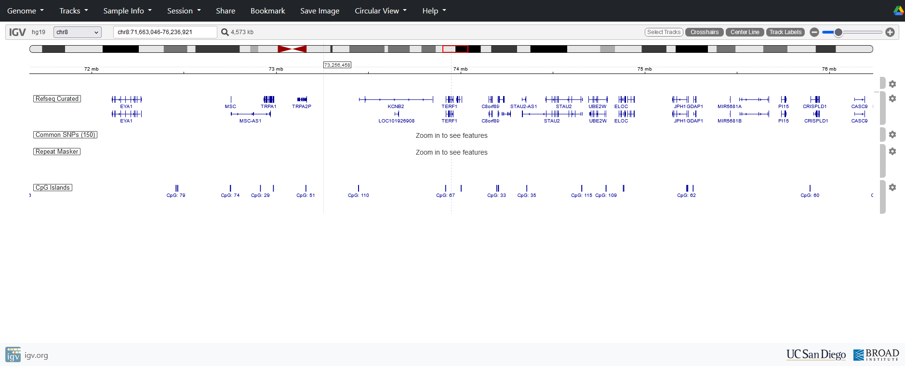{fig-alt="The region surrounding the TERF1 gene in IGV"}

**Exons** are indicated by the dark blue boxes with coding regions taller than the non-coding parts of the exons. **Introns** are indicated by the thin blue line, with the direction of transcription indicated by small arrows (\>).

Zoom in to see the structure of the *TERF1* gene (there are two primary transcripts for this gene):

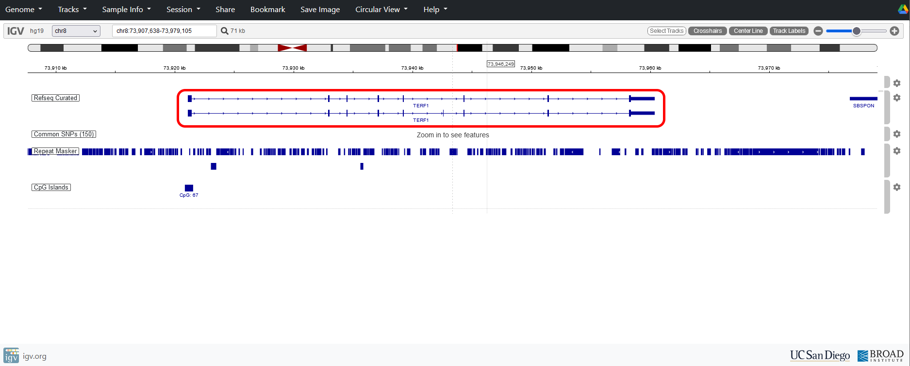{fig-alt="A figure highlighting the open reading frame of TERF1"}

::: {.callout-tip title="Test your understanding"}
- How many exons does the *TERF1* gene have?
:::

::: {.callout-tip collapse="true" title="Answer"}
*TERF1* has two primary transcripts, one with 9 exons (upper) and one with 10 (lower).
:::

Move exon 1 of *TERF1* to the centre and zoom in some more. You should  start to see the reference sequence appearing. You can also press the cog on the track to turn on “Three-frame translation” to aid in interpretation. This shows the amino acid sequences corresponding to the three possible reading frames of the DNA sequence.

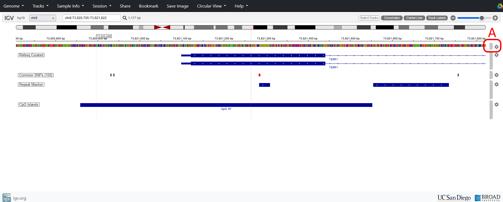{fig-alt="A figure highlighting the cog used to edit settings for a track in IGV, including how to add three-frame translation"}

## Add promoter-associated chromatin data

We can add some additional information about the accessibility of DNA in this region by adding an ENCODE Signal track containing ChIP-seq data for H3K4me3 (trimethylation of lysine 4 on histone H3). This histone variant is associated with open chromatin and marks active promoters in the genome, typically appearing near transcription start sites (TSSs).

Add the ENCODE H3K4me3 track and select the ‘GM12878 H3K4me3 | Raw Signal | Biorep 1’ experiment near the bottom of the list and press OK to add the track.

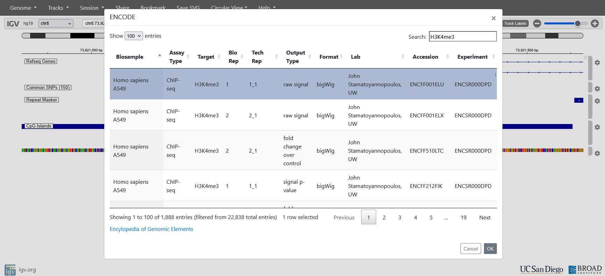{fig-alt="A figure showing how to add the H3K4me3 track to IGV"}

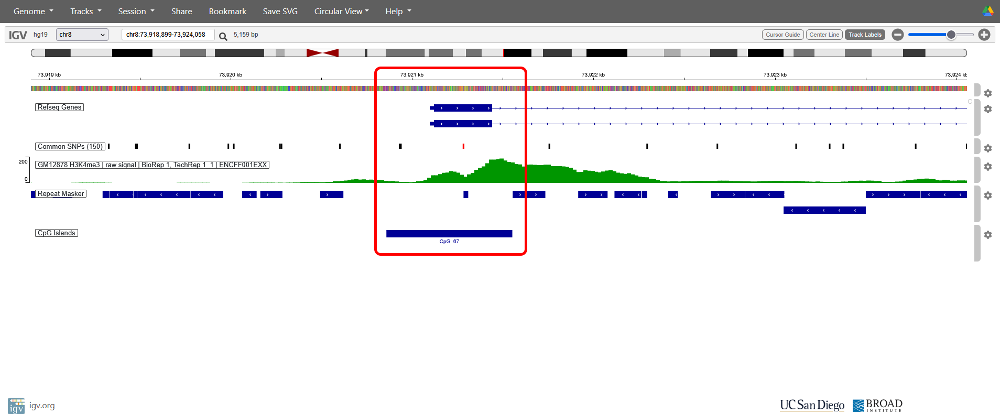{fig-alt="A figure showing the start of TERF1, including CpG islands and H3K4me3 regions in IGV"}

::: {.callout-tip title="Test your understanding"}

- Is CpG island 67 positioned where you expect it to? (zooming in might help)
- Why?
- Which of the three reading frames do you think is correct for exon 1?
- What is the name of the first repeated element in intron 1?

:::

::: {.callout-tip collapse="true" title="Answer"}
- Yes, CpG island 67 spans a promoter region in exon 1 and associates with H3K4me3 ChIP-seq data (typically found at TSSs and in open chromatin).
- The correct frame starts with an ATG and has no STOP codons within exon 1. It will depend on your particular instance of IGV.
- The first repeated element is a MIRb element and there are some additional Alu, LINE and MIR elements, and simple sequence repeats, further down. Note that ~80% of intron 1 sequence is some sort of repeat.
:::

## Examine splice junctions

Splice junctions mark the boundaries between exons and introns and are critical for the accurate removal of intronic sequence during RNA splicing. Adjust the view to examine the end of the first exon.

::: callout-warning
Be careful - the vertical order of the reading frames sometimes jumps about as you zoom in and out.
:::

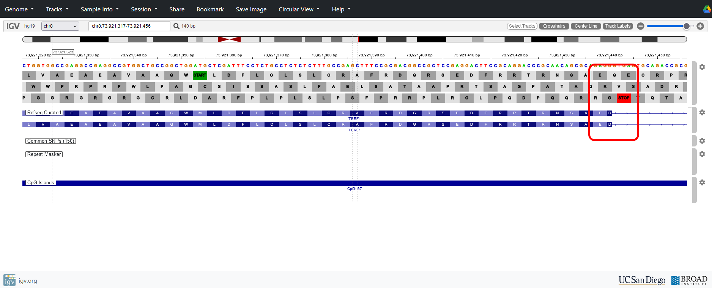{fig-alt="A figure showing the end of the first TERF1 exon in IGV, showing the splice donor site"}

::: {.callout-tip title="Test your understanding"}
- What is the sequence of the last codon of exon 1?
- What is the sequence of the first two bases of the intron?
- Why is this important?
:::

::: {.callout-tip collapse="true" title="Answer"}
- It will depend on your IGV instance but in this image it is the bottom frame as this matches the start codon at the beginning of the transcript, so the last codon is **G--**
- The first two bases of the intron are GT
- This is the consensus splice donor site
:::

Adjust the view to examine the end of the first intron and the beginning of the second exon.

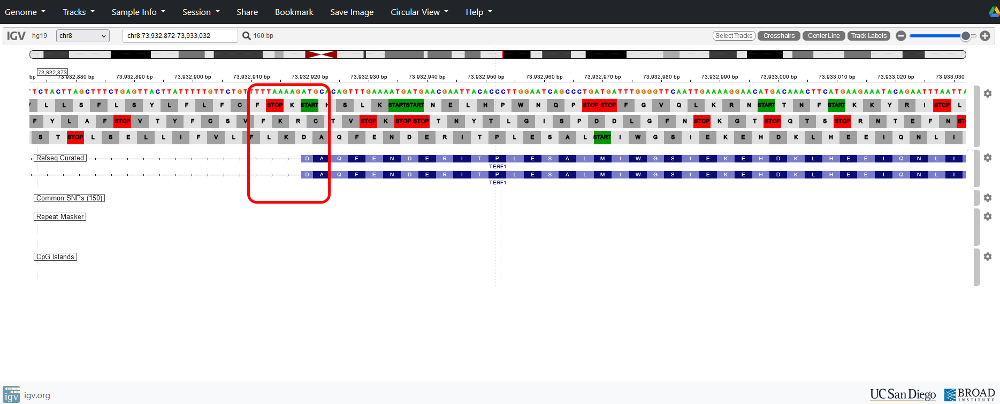{fig-alt="A figure showing the start of the second TERF1 exon in IGV, showing the splice acceptor site"}

::: {.callout-tip title="Test your understanding"}

- What is the sequence of the first codon of exon 2?
- What codon is formed after splicing when the final base of exon 1 is combined with the first two bases of exon 2?
- Which amino acid does it encode (see below for the genetic code)?
- What is the sequence of the last two bases of the intron?
- Why is this important?

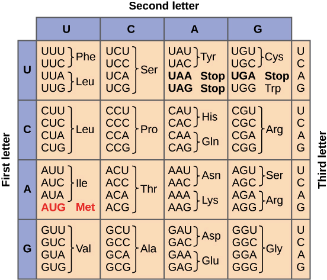{fig-alt="A reminder of the genetic code" style="border: none;"}
:::

::: {.callout-tip collapse="true" title="Answer"}
-  The codon so far contains **G--** and was split by the intron. To make it a complete triplet, the rest of the codon must be the *-AT* from exon 2.
- GAT.
- Aspartic Acid (D)
- The last two bases are AG
- This is the consensus splice acceptor site.
:::

Scroll through the gene and note how the intronic sequences are comprised largely of dispersed repeat sequences.

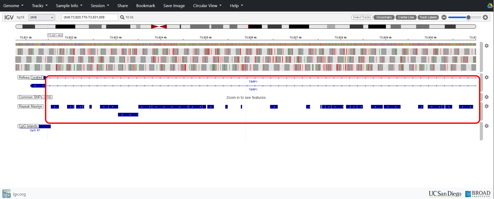{fig-alt="A figure highlighting an intron in TERF1 in IGV"}

## Examine the terminal exon and 3' UTR

Navigate to the terminal *TERF1* exon and zoom in:

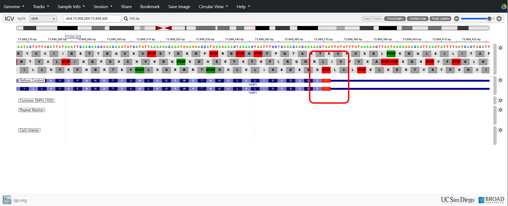{fig-alt="A figure showing the end of the final exon of TERF1 in IGV, showing part of the 3' UTR and stop codon"}

::: {.callout-tip title="Test your understanding"}

- Which is the correct reading frame for this exon in your view?
- What is the sequence of the stop codon?
:::

::: {.callout-tip collapse="true" title="Answer"}
- It will depend on your IGV instance but in this image it is the bottom frame as the stop codon coincides with the end of the terminal exon.
- TGA
:::

Zoom out to see the whole of the final exon.

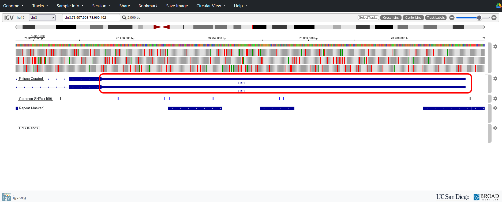{fig-alt="A zoomed in view of the TERF1 3' UTR in IGV"}

::: {.callout-tip title="Test your understanding"}
- What is the approximate length of the 3’ UTR for *TERF1*?
:::

::: {.callout-tip collapse="true" title="Answer"}
The UTR spans 73,960,358 to 73,958,372 so is 1,986 bases (approx. 2,000 bp)
:::
