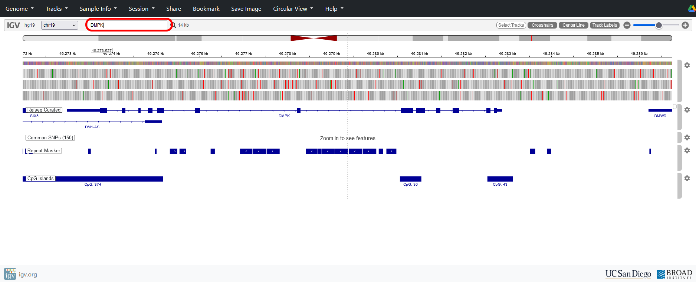
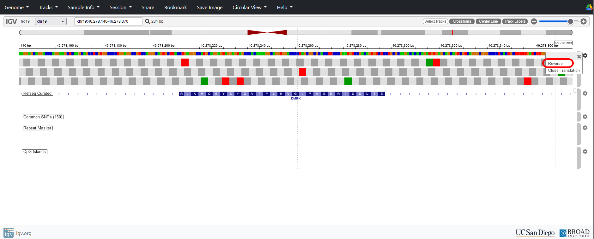
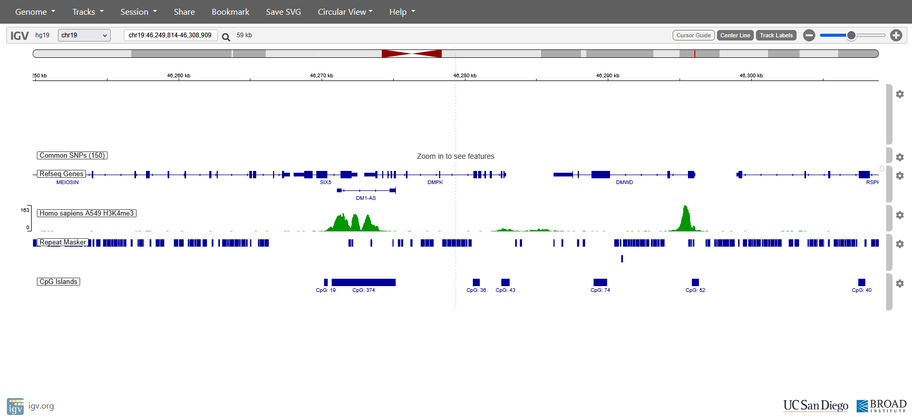

# 4: Genes on the reverse strand: *DMPK*

Let’s look at the *DMPK* gene. This gene is different from *TERF1* as it is transcribed from the bottom strand relative to the chromosomal reference (the top strand). Exon 1 is on the right, and the terminal exon on the left. You can quickly navigate to *DMPK* (or any gene) by typing its name into the search bar.

{fig-alt="Screenshot from slide 25 of the original IGV tutorial."}

Zoom in on one of the DMPK coding exons. To see the correct amino acid sequence for we will have to set the ‘reverse’ option so that IGV translates from the bottom strand - remember that it will still be running right to left.

::: callout-warning
Don’t forget to turn this option off again if you look at a gene or variants on the reference (top) strand.
:::

{fig-alt="Screenshot from slide 26 of the original IGV tutorial."}

Zoom out a bit more to get an overview of the other genes in the vicinity of *DMPK*. Some genes are in the same orientation as DMPK and transcribed from the bottom strand (e.g.SIX5, DMWD, RSPH6A) but others are transcribed from the top strand (e.g. BHMG1).

You should also see that many genes have a CpG island spanning exon 1. These regions are often (but not always) associated with the presence of H3K4me3 in ChIPseq data, indicating open chromatin.

{fig-alt="Screenshot from slide 27 of the original IGV tutorial."}

