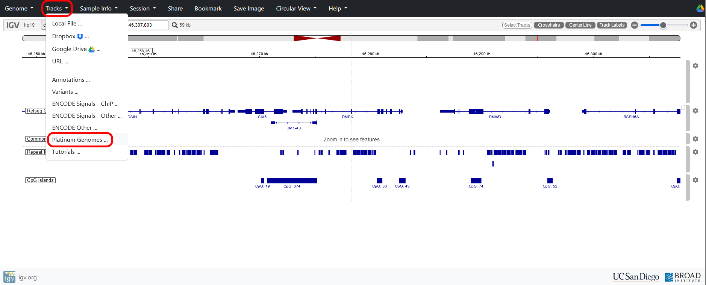
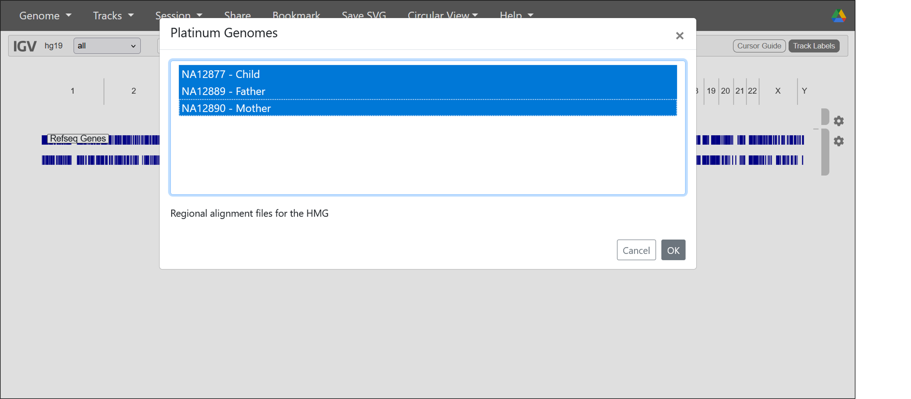
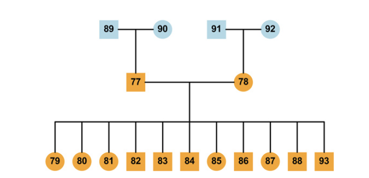
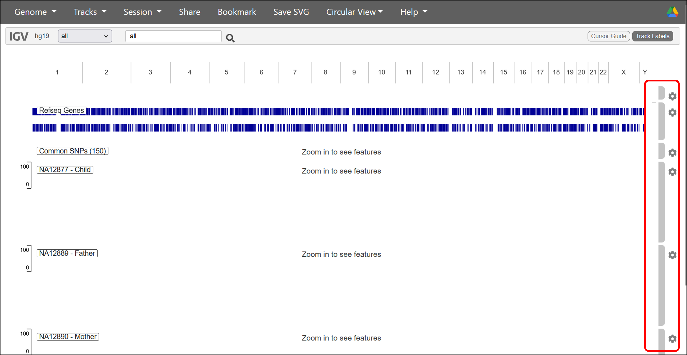
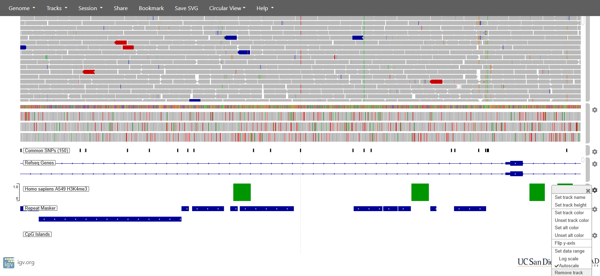

# 6: Load Platinum Genomes sequencing data

Next, we will load some actual sequence data from the platinum genomes collection of tracks:

{fig-alt="How to load the Platinum genomes tracks in IGV"}

SHift-click samples **NA12889**, **NA12890** and **NA12877** and press OK.

{fig-alt="Selecting the parent-child trio in the Platinum genomes"}

The platinum genomes are derived from a reference genome dataset described in [Eberle *et al., 2017*](https://genome.cshlp.org/content/27/1/157). In the study, the genomes of four grandparents, two parents and 11 children were sequenced on an Illumina HiSeq2000 to an average depth of 50× using 2×100 bp paired-end reads.

The ID of each sample is defined by adding the family identifier prefix (e.g. NA128) to each numbered individual (e.g. 77 would be NA12877). For this session, we will load in a mother-father-child trio  (individuals 89, 90 and 77) from family NA128.

{fig-alt="Overiview of the Platinum genomes pedigree" style="border:none;"}

You may need to use the cog associated with each track to change the Track Height to get everything visible on your screen. You can also drag the tracks into an easier order using the handles at the side of each track.

{fig-alt="How to move and change settings for the various tracks open in IGV"}

We can speed up the display by removing tracks we no longer need (e.g. CpG, repeats and H3K4me3) by clicking their specific cog on the track and selecting remove.

{fig-alt="How to remove tracks in IGV"}

::: callout-warning
Note that  sometimes IGV still slow down when you load the sequence data and you may need to refresh the page if it gets stuck. Unfortunately, you will then need to change the genome to hg19 again and reload the relevant tracks again.
:::

