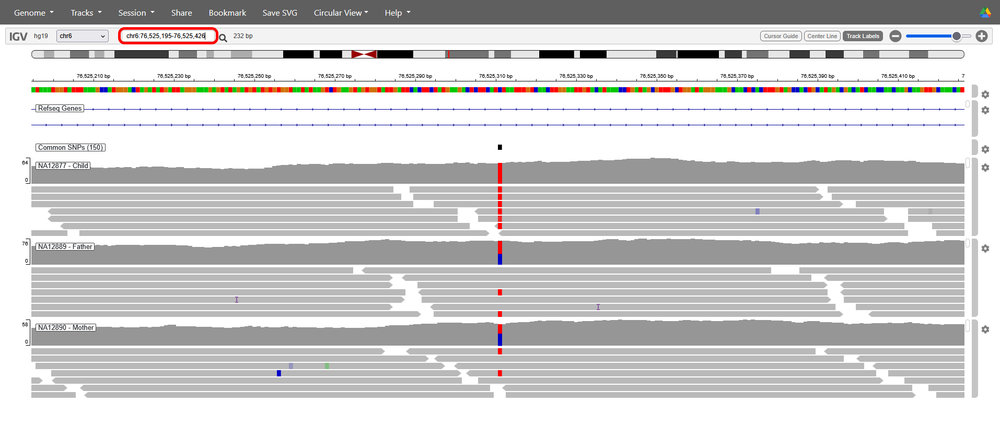
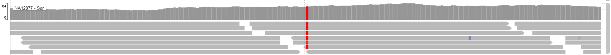
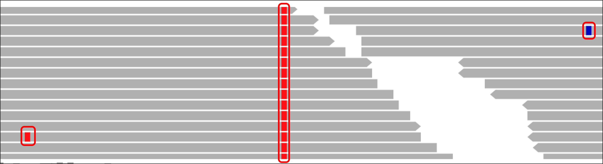
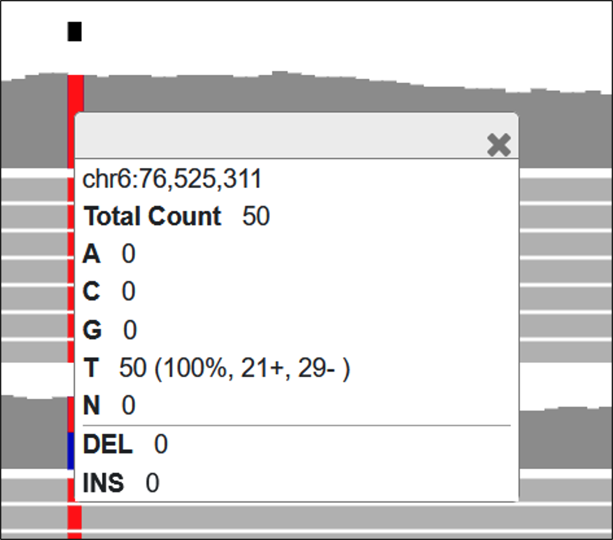
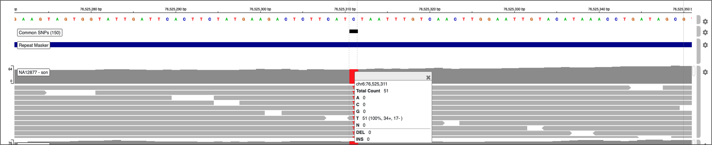
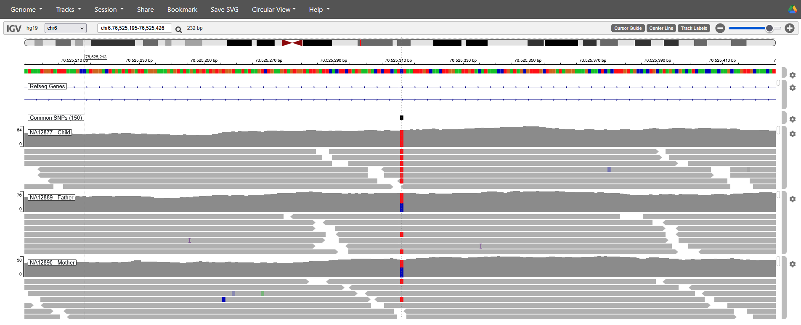
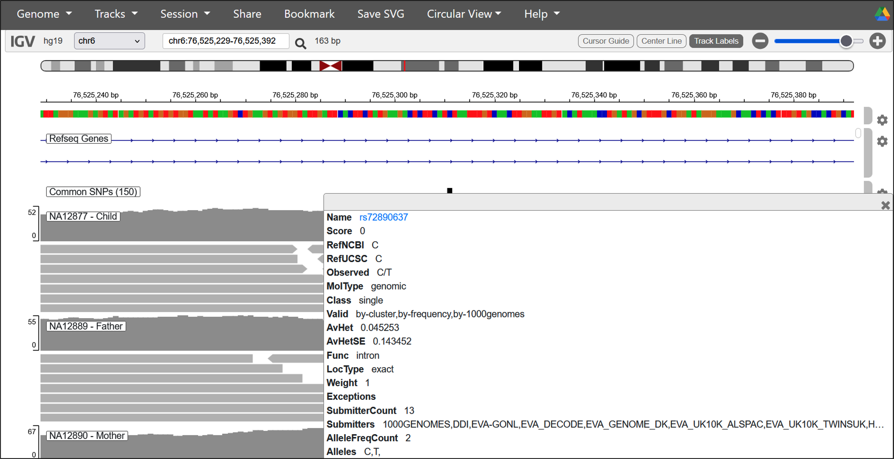

# 7: Inspect reads and identify variants in *MYO6*

Let’s zoom in and have a look at a region in the *MYO6* gene of the trio in detail by typing the chromosome coordinates into the search box: chr6:76,525,195-76,525,426. 

*MYO6* mutations are linked to autosomal dominant and autosomal recessive inherited hearing loss.

::: callout-warning
We will be examining variants in the top reference strand, so it is best to turn off the ‘reverse’ option for this region unless looking at whether a variant is synonymous
:::

{fig-alt="Selecting a position by region coordinates in IGV"}

The mountain plot at the top of the display shows the read depth across the region (the scale here goes from 0 to 52x). Individual 100 bp reads are shown as grey rectangles - the arrow on the end indicating the direction of the read (you can use the scroll bar here to see more of the reads).

- Where a base in a read is the same as the reference, it is coloured grey
- Where a base in a read is different to the reference, it is coloured by base.

{fig-alt="A zoomed in view showing that bases in the pileup that are the same as the reference are grey in IGV, whereas differences are coloured by base"}

Zooming in even closer we can see the actual sequences and identify any differences between the reads and the reference.

{fig-alt="A zoomed in view highlighting sites in the pileup that are different to the reference" width="50%"}

To gauge whether any sequence differences might represent germline variants, we can examine the bases observed at each position by clicking on a base in the mountain plot at the top of each read track.

{fig-alt="A view of the pileup statistics at a position revealed by clicking the mountain plot in IGV" width="50%"}

::: {.callout-tip title="Test your understanding"}
- What do you think is the germline genotype for NA12877 (the son) at position ch6:76,525,300?
- What are the possible sources of the G read observed?
:::

::: {.callout-tip collapse="true" title="Answer"}
- This position appears to be homozygous A (A/A) because all the reads are the same
- Most likely a sequencing error, but could possibly be a rare somatic variant
:::

Moving along slightly to  position 76,525,311:

{fig-alt="A view of the pileup statistics at a different position revealed by clicking the mountain plot in IGV"}

::: {.callout-tip title="Test your understanding"}
- What is the reference sequence at position chr6:76,525,311?
- What is the germline genotype at position chr6:76,525,311 for NA12877 (the son)?
- How sure are we that this is not a sequencing error?
:::

::: {.callout-tip collapse="true" title="Answer"}
- The reference sequence at position chr6:76,525,311 is **C**
- The germline genotype at position chr6:76,525,311 for NA12877 is Homozygous T (T/T)
- All 51 reads contained T at this position, making a sequencing error highly unlikely. The germline genotype is therefore very likely to be T/T

:::

Examine the reads for the other members of the trio.

{fig-alt="A zoomed out view showing how the mountain plots are coloured differently at homozygous regions compared to heterozygous regions in IGV"}

::: {.callout-tip title="Test your understanding"}
- What are the genotypes at position chr6:76,525,311 for NA12889 and NA12890?
- Are the predicted genotypes consistent with Mendelian expectations?
:::

::: {.callout-tip collapse="true" title="Answer"}
- Both parents are heterozygous T/C
- The pattern does fit with Mendelian expectations: father T/C, mother T/C and son T/T suggest the son inherited a T from each parent
:::

By clicking on the feature in the Common SNPs track we can see that this is a known SNP and gain additional information:

{fig-alt="A zoomed in view showing the SNP stats revealed by clicking the position in the common snps track in IGV"}

::: {.callout-tip title="Test your understanding"}
- What is the identifier (name) of the SNP at this position?
- What is the minor allele frequency (MAF)?
:::

::: {.callout-tip collapse="true" title="Answer"}
- The SNP identifier is rs72890637
- The MAF is 0.023
:::