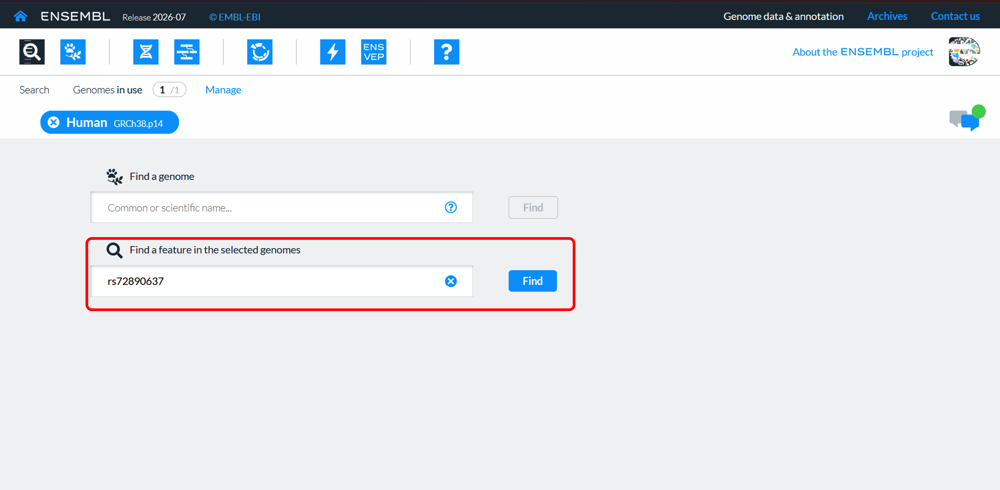
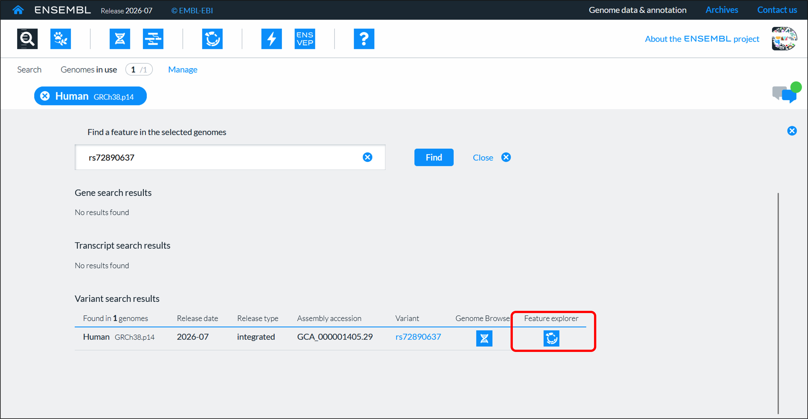
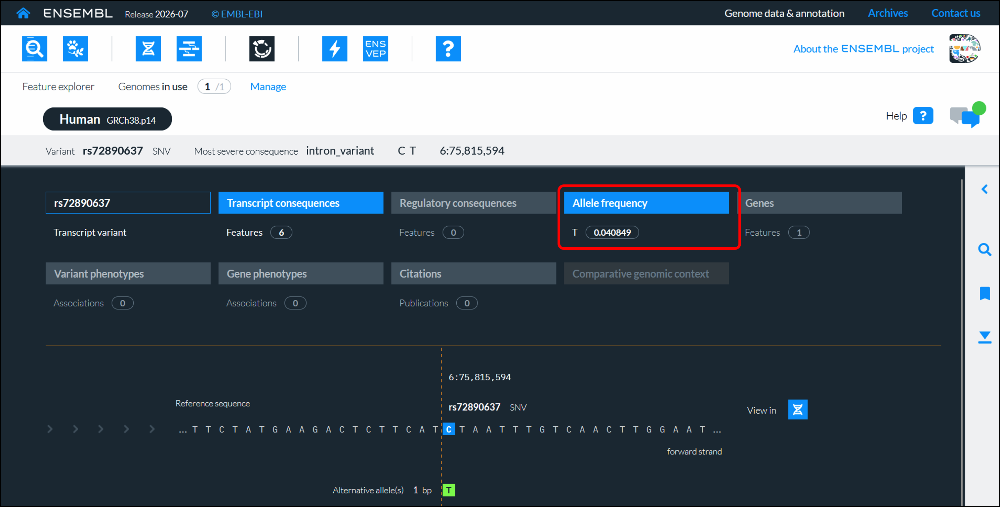

# 8: Investigate variants using Ensembl

We can find out even more about this SNP using the [Ensembl database](https://www.ensembl.org/search). Enter the SNP identifier (rs72890637) into the Ensembl search box (If Ensembl search is down, use the [direct link to the SNP](https://www.ensembl.org/feature-explorer/GCA_000001405.29/variant:6:75815594:rs72890637?allele=0))

{fig-alt="A screenshot demonstrating how to search on Ensembl"}

Then click on the link in the Ensembl **Feature explorer** search results.

{fig-alt="A screenshot demonstrating how to get to search results on Ensembl"}

There are then links to various pieces of data about the SNP. Click on the **Allele Frequency** link.

{fig-alt="A screenshot demonstrating how to see details of the allele frequencies on Ensembl"}

::: {.callout-tip title="Test your understanding"}
- What is the minor allele frequency in Finland? (you may have to expand the gnomAD genomes v4.1 dataset)
- How does that compare to the wider, non-Finnish European population? 
:::
