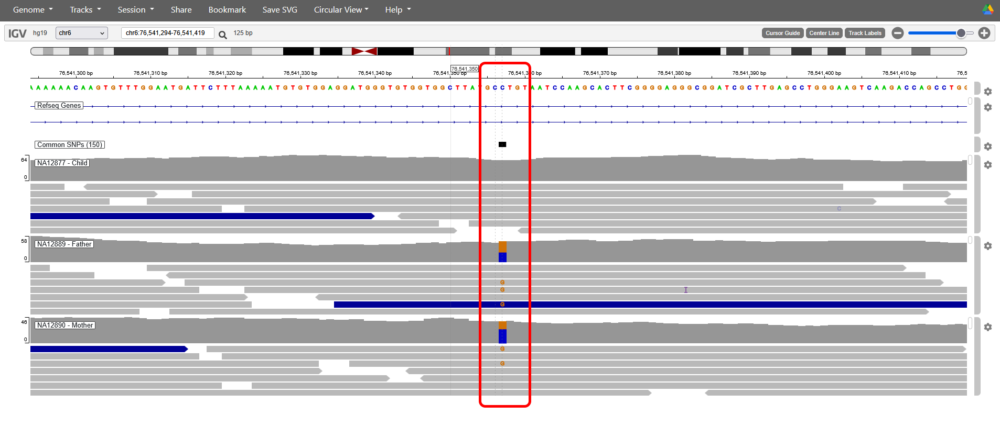
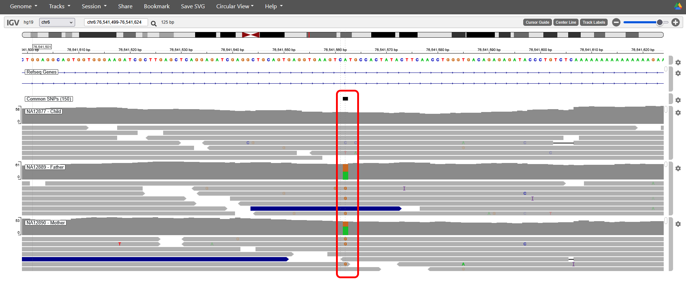
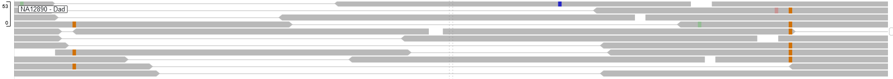
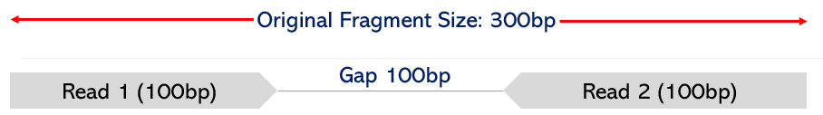
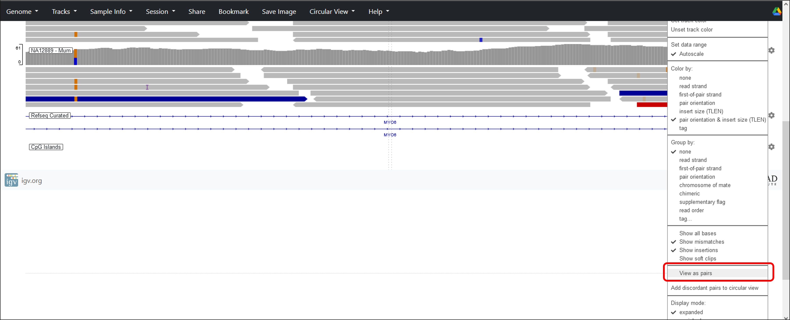

# Genotypes, inheritance and haplotypes

Let’s look at a few more variants. To start with, we'll focus on rs1280055. We can jump straight to this SNP by typing its ID into the IGV search bar.

{fig-alt="Screenshot from slide 44 of the original IGV tutorial."}

::: {.callout-tip title="Test your understanding"}
- What are the genotypes at rs1280055 for NA12877, NA12889 and NA12890?
- Are they consistent with Mendelian inheritance patterns?
:::
    
::: {.callout-tip collapse="true" title="Answer"}
- The genotypes are C/C for NA12877 (child), G/C for NA12889 (father) and G/C for NA12890 (mother)
- These are consistent with Mendelian inheritance and the child has inherited a C allele from each heterozygous parent

:::

Scroll along a few hundred bases to the right and you should find another SNP -  rs1280056.

{fig-alt="Screenshot from slide 45 of the original IGV tutorial."}

::: {.callout-tip title="Test your understanding"}
- What are the genotypes at rs1280056 for NA12877, NA12889 and NA12890?
:::

::: {.callout-tip collapse="true" title="Answer"}
The genotypes are A/A for NA12877 (child), A/G for NA12889 (father) and A/G for NA12890 (mother)
:::

To determine which variants have been inherited together on the same chromosome, and hence which parents they likely came from, we can ‘phase’ the sequence to determine haplotypes. In the example below, a G at rs1280055 is always found with a G in rs1280056 in mate pairs that cover both SNPs. Conversely, a C in rs1280055 is always found with an A in rs1280056. This allows us to infer the haplotype for the sample.

{fig-alt="Screenshot from slide 47 of the original IGV tutorial."}

By using paired reads, we can look at much longer sequence distances than the 100 bp length of each individual read.

{fig-alt="images/pairedexample.png" width=50% style="border:none;"}

::: callout-tip
To help, we can use “view as pairs” in the parents to look for direct physical evidence of the parental haplotypes. This setting adds a line between read-pairs in the sequencing data, allowing us to see sequence that comes from the same fragment and originated from a single physical position in the genome.

{fig-alt="Screenshot from slide 48 of the original IGV tutorial."}

:::

::: {.callout-tip title="Test your understanding"}

Use the family data and any read-pairs to phase the variants in the table and determine the haplotypes for rs1280056 and rs1280055 in NA12877, NA12889 and NA12890 (Don’t forget to scroll up and down to view more reads). You may have to zoom to get both SNPs on screen at the same time.

| Sample | Result | rs1280056 | rs1280055 |
|:-------|:-------|:---------:|:---------:|
|        | **Position** | chr6:76,541,531–76,541,593 | chr6:76,540,356–76,542,357 |
|        | **Reference allele** |  |  |
|        | **Alternative allele** |  |  |
| **NA12889 (father)** | **Genotype** |  |  |
|                       | Haplotype 1 |  |  |
|                       | Haplotype 2 |  |  |
| **NA12890 (mother)** | **Genotype** |  |  |
|                       | Haplotype 1 |  |  |
|                       | Haplotype 2 |  |  |
| **NA12877 (son)** | **Genotype** |  |  |
|                    | Haplotype 1 |  |  |
|                    | Haplotype 2 |  |  |

: Genotypes and inferred haplotypes at rs1280056 and rs1280055. {#tbl-family-haplotypes}
:::

::: {.callout-tip collapse="true" title="Answer"}
| Sample | Result | rs1280056 | rs1280055 |
|:-------|:-------|:---------:|:---------:|
|        | **Position** | chr6:76,541,562 | chr6:76,541,218 |
|        | **Reference allele** | A | C |
|        | **Alternative allele** | G | G |
| **NA12889 (father)** | **Genotype** | A/G | C/G |
|                       | Haplotype 1 | A | C |
|                       | Haplotype 2 | G | G |
| **NA12890 (mother)** | **Genotype** | A/G | C/G |
|                       | Haplotype 1 | A | C |
|                       | Haplotype 2 | G | G |
| **NA12877 (son)** | **Genotype** | A/A | C/C |
|                    | Haplotype 1 | A | C |
|                    | Haplotype 2 | A | C |
:::
