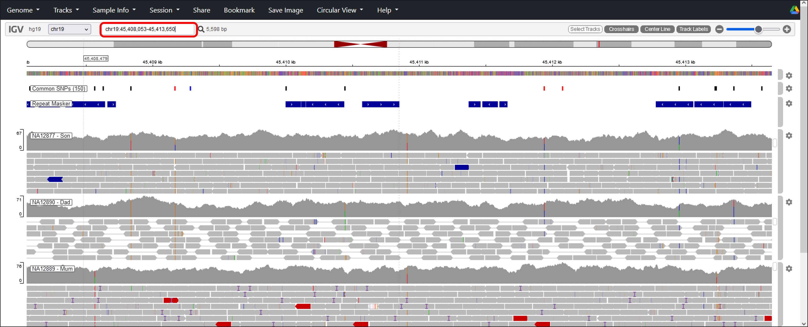
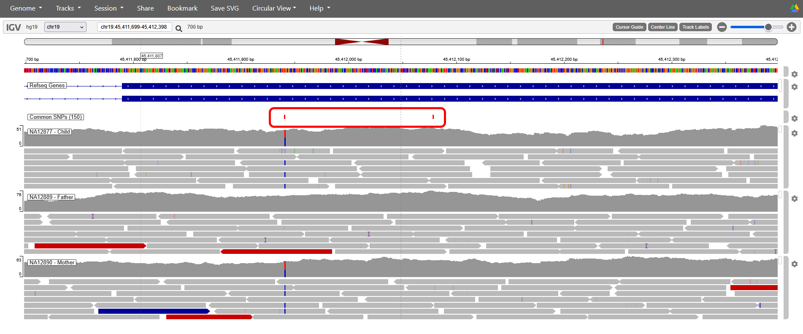
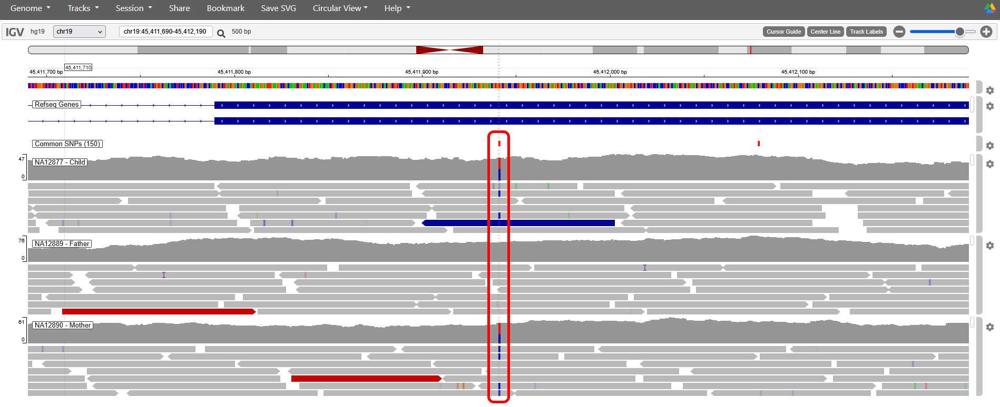
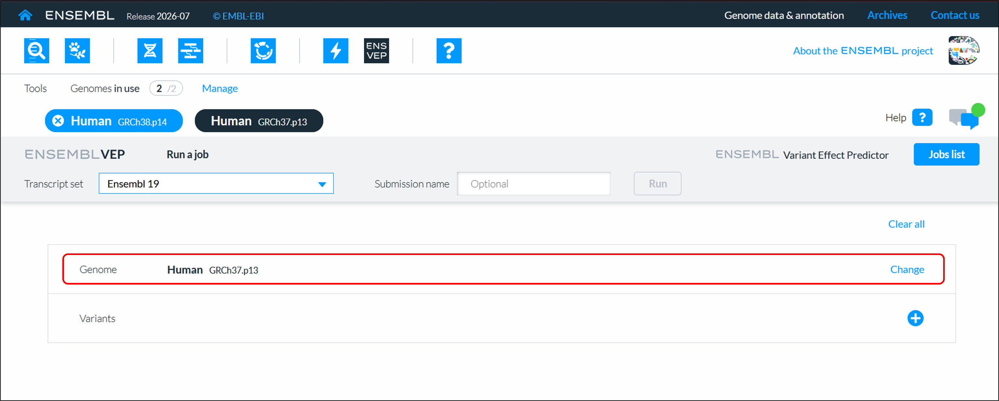
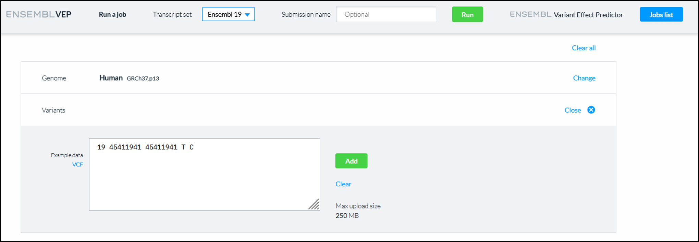
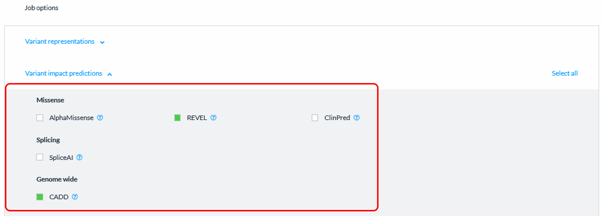
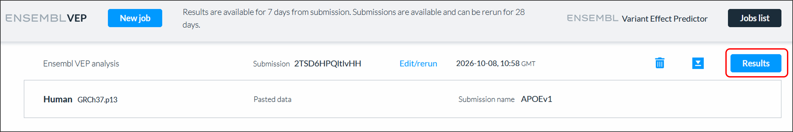
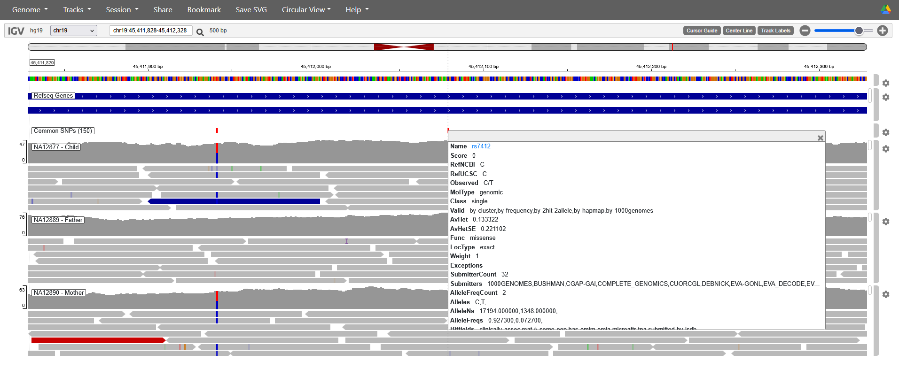

# 10: Variant effect predictor with *APOE*

Next, we'll look at the *APOE* gene. You can quickly locate it using the search box.

{fig-alt="A zoomed out view showing the APOE1 region in IGV"}

Focus on the two common SNPs found in exon 4.

{fig-alt="A view showing to close SNPs in the APOE1 gene in IGV"}

Start with the variant at position chr19:45,411,941 (rs429358).

{fig-alt="A zoomed in view showing the coloured positions in the different Platinum genomes for the rs429358 SNP in IGV"}

::: {.callout-tip title="Test your understanding"}
- What is the nature of the polymorphism at the DNA level?
- Does this variant change the amino acid sequence (You will have to turn translation and work out which is the reading frame by looking at Exon 1)?
- If so, from what to what?
- What are the genotypes at this SNP for NA12877, NA12889 and NA12890?
- What is the minor (alt) allele and the MAF?
- What type of variant is this – would it impact the protein? 
:::

::: {.callout-tip collapse="true" title="Answer"}
- The polymorphism at this site is C/T
- Yes, this is a non-synonymous mutation
- The codon and amino acid changes from TGC (Cys) to CGC (Arg) 
- The genotypes are C/T for NA12877 (child), T/T for NA12889 (father) and C/T for NA12890 (mother)
- The MAF for the minor (alt) C-allele is 18%
- This mis-sense variant is protein altering. It is associated with predisposition to late onset Alzheimer disease (amongst other associations)

:::

We can use the **variant effect predictor (VEP)** tool to gain some insight into potential functional effects of a given variant. Navigate to the VEP site: [https://www.ensembl.org/tools/vep](https://www.ensembl.org/tools/vep){target="_blank" rel="noopener noreferrer"}

::: callout-warning
We will be using hg19/GRCh37 coordinates, so make sure you are have the right genome version selected.

{fig-alt="A screenshot demonstrating how to change genome in Ensembl VEP"}

:::

A VEP search string has to be in a set format: 

```
19 45411941 45411941 T C
```

- The first number is the **Chromosome**
- The second number is the start position
- The third number is the end position (for a SNP, this is the same as the start position)
- The fourth character is the wild-type base
- The fifth character is the variant base(s) that the position will change to

Press “Add” when you’ve entered the details of the variant. Set the **submission name** to something you will remember.

{fig-alt="A screenshot demonstrating how to format a search string in Ensembl VEP"}

We can also add some additional analyses to the job by scrolling down to **Job Options**. For now Enable **REVEL** and **CADD** under **Variant impact predictions**. These will help us predict any effect that the variants might have.

::: callout-tip
**REVEL (Rare Exome Variant Ensemble Learner)** is a computational tool that predicts whether a **missense** variant is likely to be disease-causing by combining the results of multiple variant effect prediction algorithms into a single score between 0 and 1. Higher REVEL scores indicate a greater likelihood that the variant is pathogenic, while lower scores suggest it is more likely to be benign. Although there are no set thresholds, a general rule of thumb is:

- 0.8+ : Pathogenic
- 0.5-0.8 : Likely Pathogenic
- 0.2-0.5 : Likely benign
- <0.2 : Benign

(Ioannidis NM, Rothstein JH, Pejaver V, et al. (2016) "REVEL: An Ensemble Method for Predicting the Pathogenicity of Rare Missense Variants." *American Journal of Human Genetics* 99(4):877-885. [DOI:10.1016/j.ajhg.2016.08.016](https://www.sciencedirect.com/science/article/pii/S0002929716303706?via%3Dihub){target="_blank" rel="noopener noreferrer"})

**CADD (Combined Annotation Dependent Depletion)** is a variant prioritisation score that integrates multiple genomic annotations to predict the deleteriousness of genetic variants. Higher CADD PHRED scores indicate a greater likelihood of functional impact, with scores above 20 typically considered potentially damaging.

CADD scores are ranked so that a score of 10 places a variant among the top 10% most deleterious variants in the genome, while a score of 20 places it among the top 1%.

Although there are no set thresholds for CADD, a general rule of thumb is:

- 30+  : Deleterious
- 20-30 : Potentially deleterious
- 10-20 : Unlikely to be deleterious
- <10 : Not deleterious

(Rentzsch P, Witten D, Cooper GM, Shendure J, Kircher M. (2019) "CADD: predicting the deleteriousness of variants throughout the human genome." *Nucleic Acids Research* 47(D1):D886-D894. [DOI:10.1093/nar/gky1016](https://academic.oup.com/nar/article/47/D1/D886/5146191){target="_blank" rel="noopener noreferrer"})

:::

{fig-alt="A screenshot demonstrating how to add REVEL and CADD information to a search in Ensembl VEP"}

Press “Run” when you’re ready. Your job will take a few minutes. Press **Pesults** when it has finished.

{fig-alt="A screenshot demonstrating how to get to the results of a search in Ensembl VE"}


::: {.callout-tip title="Test your understanding"}
- What type of variant is this?
- What might the REVEL score indicate about this variant? (You might have to click show annotations to see these details)
- What might the CADD score indicate about this variant? (You might have to click show annotations to see these details)

:::

::: {.callout-tip collapse="true" title="Answer"}
- This is a missense variant
- A REVEL score of 0.229 is low and would generally be interpreted as evidence that the variant is likely benign (not disease-causing). 
- A CADD PHRED score of 13.75 suggests the variant is unlikely to be deleterious.These low scores are probably because the MAF is high (~15%) and isn’t likely to be associated with anything too serious - remembering that Alzheimer disease is very common, and very serious, but usually only affects people after their reproductive age 

:::

There is another SNP a bit further downstream (rs7412) we will examine next. 

{fig-alt="A zoomed in view showing the coloured positions in the different Platinum genomes for the rs7412 SNP in IGV"}

::: {.callout-tip title="Test your understanding"}
- What is the nature of the polymorphism at the DNA level?
- Does this variant change the amino acid sequence?
- If so, from what to what?
- What are the genotypes at this SNP for NA12877, NA12889 and NA12890?
- Is this variant likely to be pathogenic? (check using VEP)
:::

::: {.callout-tip collapse="true" title="Answer"}
- The polymorphism is C/T
- Yes, this is a non-synonymous mutation
- The codon and amino acid changes from CGC (Arg) to (TGC) Cys
- The variant has a higher REVEL score of 0.588 (use `19   45412079 45412079 C T` to search)

:::
